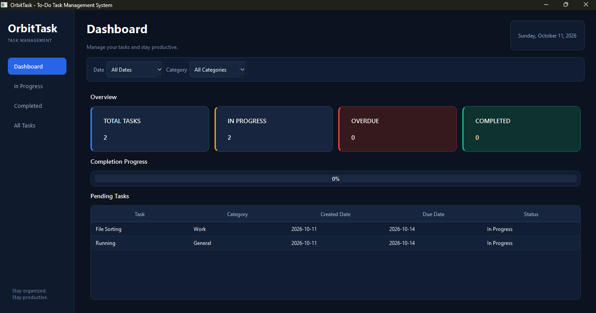
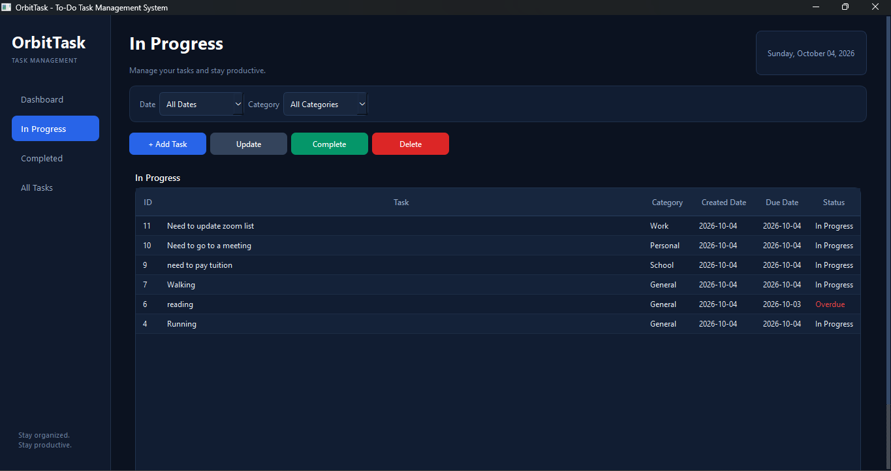
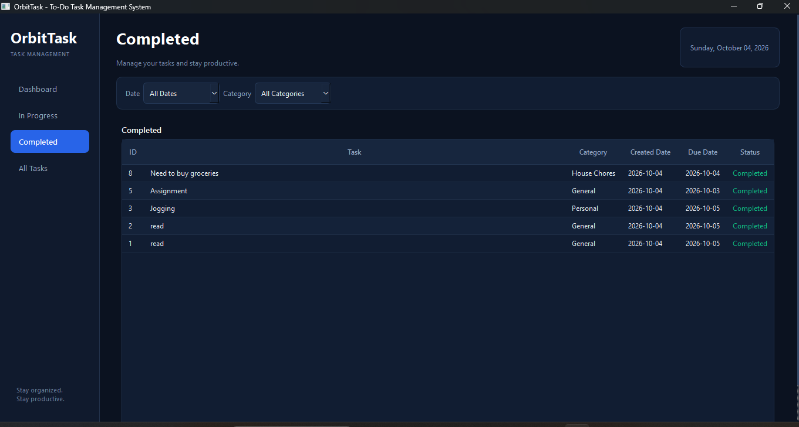
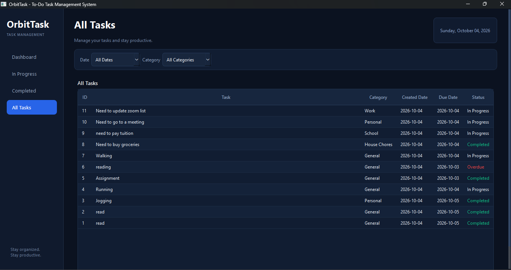

# OrbitTask – To-Do Task Management System

OrbitTask is a desktop-based To-Do Task Management System built with **Python**, **PyQt6**, and **SQLite**. It helps users create and organize tasks, set deadlines, track task status, and monitor progress through a dashboard.

## About

Keeping track of tasks manually can make it difficult to remember deadlines and know which tasks still need attention. OrbitTask provides one place to record tasks, organize them by category, view unfinished and completed work, and identify overdue tasks.

## Features

### 1. Dashboard
- Displays task statistics and overall completion progress.
- Shows unfinished tasks so users can focus on work that still needs to be done.
- Updates when task information or filters change.

### 2. Task Management
The four main task operations are grouped in `features/Main_Feature/task_operations.py`. The GUI in `features/Tasks/view.py` only builds the interface and connects its buttons to this module; it does not contain the Add, Update, Complete, or Delete operation methods.

- **Add Task** – Create a task with a description, category, created date, and due date.
- **Update Task** – Edit an existing task's information.
- **Complete Task** – Mark an unfinished task as completed.
- **Delete Task** – Remove a selected task from the system.

### 3. Categories
- Organizes tasks by category.
- Supports the default categories General, School, House Chores, Work, and Personal.
- Allows users to enter custom categories.

### 4. Task Status Tracking
- **In Progress** – The task is unfinished and its deadline has not passed.
- **Overdue** – The task is unfinished and its due date has passed.
- **Completed** – The task has been marked as finished.

### 5. Filters and Task Pages
- Filter tasks by category and date.
- Date filters include Today, Yesterday, This Week, This Month, All Dates, and Custom Date.
- Separate pages are available for Dashboard, In Progress, Completed, and All Tasks.

### 6. SQLite Database
Stores task information locally so it remains available when the application is closed and reopened.

## Technologies Used

| Technology | Purpose |
|---|---|
| Python | Main programming language |
| PyQt6 | Desktop graphical user interface |
| SQLite / `sqlite3` | Local data storage and database access |
| QSS | Application styling |
| `dataclasses` | Task model structure |
| `datetime` | Date handling and overdue status |
| PyCharm | Development environment |

## Project Structure

```text
OrbitTask/
├── database/
│   ├── __init__.py
│   └── database.py
├── features/
│   ├── __init__.py
│   ├── Main_Feature/
│   │   ├── __init__.py
│   │   └── task_operations.py
│   └── Tasks/
│       ├── __init__.py
│       ├── model.py
│       ├── repository.py
│       ├── service.py
│       └── view.py
├── screenshots/
│   ├── dashboard.png
│   ├── in-progress.png
│   ├── completed.png
│   └── all-tasks.png
├── .gitignore
├── main.py
├── requirements.txt
├── Style.qss
└── README.md
```

### Main Files and Modules

| File / Module | Responsibility |
|---|---|
| `main.py` | Initializes the database and starts the application. |
| `database/database.py` | Creates the SQLite connection and initializes the tasks table. |
| `features/Tasks/model.py` | Defines the `Task` data model and task status. |
| `features/Tasks/repository.py` | Reads and changes task records in SQLite. |
| `features/Tasks/service.py` | Handles application logic and validates task information. |
| `features/Tasks/view.py` | Builds the GUI, task pages, tables, filters, and task dialogs; connects action buttons to the task operations module. |
| `features/Main_Feature/task_operations.py` | Handles Add, Update, Complete, and Delete Task actions outside the GUI view. |
| `Style.qss` | Defines the application's visual styling. |
| `requirements.txt` | Lists the Python packages required to run the project. |

## Installation and Setup

### Requirements
- Python 3.x
- PyQt6

### 1. Download or Clone the Project

Download the repository and open the project folder in a terminal or in PyCharm.

### 2. Install Dependencies

```bash
pip install -r requirements.txt
```

### 3. Run OrbitTask

```bash
python main.py
```

The application initializes its SQLite database when it starts.

## How to Use

### Add a Task
1. Open OrbitTask and click **Add Task**.
2. Enter the task description and category.
3. Select the created date and due date.
4. Save the task.

### Update a Task
1. Select an existing task in a page that supports task actions.
2. Click **Update** and edit the task information.
3. Save your changes.

### Complete a Task
1. Select an unfinished task.
2. Click **Complete**.
3. The task's status changes to Completed and it appears on the Completed page.

### Delete a Task
1. Select a task.
2. Click **Delete**.
3. Confirm the deletion when prompted.

### Filter Tasks
Use the date and category filters to display matching tasks. A task that has passed its due date and is not completed is identified as Overdue.

## Object-Oriented Programming

- **Classes and Objects:** `Task` represents an individual task. `TaskRepository`, `TaskService`, and `TaskView` are objects responsible for different parts of the application.
- **Encapsulation:** Task data and behavior are organized in classes, with the repository, service, and view handling separate responsibilities.
- **Inheritance:** `TaskView` inherits from PyQt6's `QMainWindow`, and `TaskDialog` inherits from `QDialog`.
- **Modular design:** The task operations are grouped in `task_operations.py`, while the service and repository handle application logic and database access.

## Database

OrbitTask uses a local SQLite database with a `tasks` table.

| Field | Description |
|---|---|
| `id` | Unique task identifier |
| `title` | Task description |
| `category` | Task category |
| `created_date` | Date the task was created |
| `due_date` | Task deadline |
| `is_completed` | `0` for not completed; `1` for completed |

The repository handles database queries. The service validates and coordinates operations, and the GUI calls the service when the user performs an action.

## Screenshots

### Dashboard


### In Progress


### Completed


### All Tasks


## Testing

The system was tested by performing the main task management operations.

| Test Case | Expected Result | Actual Result | Status |
|---|---|---|---|
| Add a new task | New task should appear in the task list | Task was added successfully | Passed |
| Update a task | Selected task information should be updated | Task information was updated | Passed |
| Complete a task | Task status should change to Completed | Task was marked as Completed | Passed |
| Delete a task | Selected task should be removed | Task was deleted successfully | Passed |
| View In Progress | Unfinished tasks should be displayed | Tasks were displayed correctly | Passed |
| View Completed | Completed tasks should be displayed | Tasks were displayed correctly | Passed |
| View All Tasks | All stored tasks should be displayed | Tasks were displayed correctly | Passed |
| Detect overdue tasks | Past-due unfinished tasks should show Overdue | Overdue tasks were identified | Passed |
| Filter by date | Matching tasks should be displayed | Date filtering worked | Passed |
| Filter by category | Matching category tasks should be displayed | Category filtering worked | Passed |

## Limitations

- **Local storage only:** Tasks are stored in a local SQLite database and are not automatically synchronized across devices.
- **Single-user application:** The system does not currently provide separate user accounts or role-based access.
- **Basic task organization:** Tasks can be organized by category and date, but priority levels and subtasks are not currently available.
- **No automatic reminders:** The application does not send email, desktop, or mobile notifications when a deadline is approaching.
- **Manual backup:** Users need to back up the local database themselves to avoid losing task data if the database file or computer is lost.
- **Platform requirements:** The application requires Python and its dependencies to be installed on the computer before it can be run from source.

## Future Improvements

- Add task priorities, tags, and subtasks to support more detailed task planning.
- Add deadline reminders and desktop notifications for upcoming and overdue tasks.
- Add task search and more advanced sorting and filtering options.
- Add database backup and restore tools.
- Add user accounts and optional cloud synchronization so tasks can be accessed on multiple devices.
- Improve automated testing for task validation, database operations, filtering, and task status changes.
- Package the application as an installer or standalone executable for easier installation.

## Author

**Name:** Cyril John Dragas  
**Section:** [Enter your section]

## Version

**OrbitTask v1.0.0**

The current version includes:

- Dashboard with task statistics and completion progress
- Add, update, complete, and delete task operations
- Dynamic task categories
- Task status tracking for In Progress, Overdue, and Completed tasks
- Date and category filters
- Separate Dashboard, In Progress, Completed, and All Tasks pages
- SQLite database persistence
- Dark-themed interface styled with QSS

## License

Created for educational purposes.
